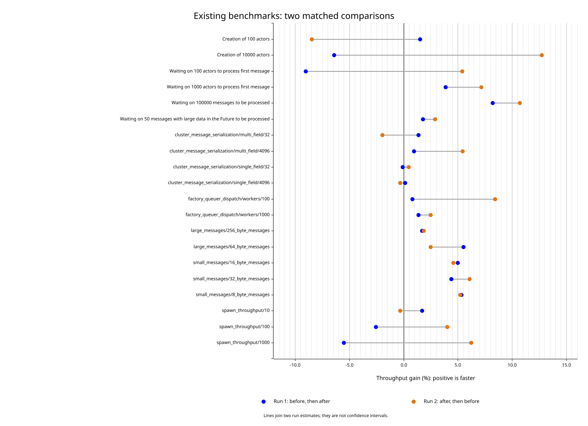

# Full benchmark comparison

Measured on November 6, 2026, for draft PR #473. This extends the original
[message scheduling investigation](message-scheduling.md) to every registered
benchmark target, using normal workload sizes rather than the smaller CI inputs.

## Findings

The improvement extends beyond the newly added placement benchmark. The existing
100,000-message loop and all five existing payload benchmarks improved in both
comparisons. The gain is concentrated in message handling; these runs do not
establish a general improvement in actor creation, spawning, or factory throughput.

| Existing workload | Throughput gain, comparison 1 | Throughput gain, comparison 2 | Interpretation |
| --- | ---: | ---: | --- |
| 100,000-message loop | +8.19% | +10.70% | Repeated improvement |
| 8-byte payloads | +5.31% | +5.21% | Repeated improvement |
| 16-byte payloads | +5.01% | +4.58% | Repeated improvement |
| 32-byte payloads | +4.41% | +6.06% | Repeated improvement |
| 64-byte payloads | +5.53% | +2.47% | Repeated improvement, smaller in comparison 2 |
| 256-byte payloads | +1.70% | +1.86% | Small repeated improvement |
| Factory, 100 workers | +0.82% | +8.42% | Variable; first comparison's confidence intervals overlap |
| Factory, 1,000 workers | +1.37% | +2.50% | Small; first comparison's confidence intervals overlap |
| Spawn and stop, 1,000 actors | -5.50% | +6.23% | No consistent direction |

The before/after 95% confidence intervals for mean batch time are separated in
both comparisons for the message loop and all five payload sizes. Actor creation
and spawn/stop results frequently change direction between comparisons. The large
creation regressions in the earlier CI comment were not reproduced consistently
on this machine with the normal workload sizes.

Serialization provides a control. Three of its four cases have combined changes
within 0.4%; the fourth has a +0.94% gain in one comparison and +5.42% in the other.
Serialization does not exercise the changed mailbox polling, so that last result
does not establish a serialization improvement caused by this change.



The chart shows two separate estimates per case. Connecting lines show their
range, not a confidence interval. Positive values indicate higher throughput or
a lower batch duration for a fixed amount of work.

## Coverage and methodology

All **62 cases** were measured four times, yielding two before/after comparisons
and 248 case executions:

| Target | Cases | Workload sizes |
| --- | ---: | --- |
| `ractor/actor` | 5 | Creation of 100/10,000 actors; first-message waits for 100/1,000 actors; 100,000-message loop |
| `ractor/async_traits` | 1 | 50 messages with a large actor state; native async traits |
| `ractor/factory` | 2 | 10,000 jobs per batch, with 100/1,000 workers |
| `ractor/simple_advanced_benchmarks` | 8 | 10,000 small messages; 1,000 large messages; spawn/stop for 10/100/1,000 actors |
| `ractor_cluster/message_serialization` | 4 | Single/multiple fields with 32-byte/4-KiB total payloads |
| `ractor/message_scheduling` | 42 | All actor placements and raw channel controls, 65,536 deliveries per batch |

- **Before runtime:** original `actor_cell.rs` and `actor_properties.rs` from
  `1af0aaad5d340cda27c5370768c6c96a0376a543`.
- **After runtime:** `f31c0ff9f70747b115611c0b27c4177177c0f72d`.
- Both variants used the benchmark harnesses from `f31c0ff`, the same build
  directory and source checkout path, identical locked dependencies, and the
  same non-yanked WASM dependency requirement. This makes the new benchmark
  available for the original runtime without changing its runtime code.
- Rust **1.97.0**, Tokio **1.52.2**, Criterion **0.7.0**, default package features,
  native async traits, span propagation enabled, and no tracing subscriber.
- Apple M4 Max, 12 performance and 4 efficiency cores, 64 GiB RAM. Legacy Tokio
  pools used `TOKIO_WORKER_THREADS=16`; the placement benchmark's explicit worker
  counts remained unchanged. Threads were not pinned to CPU cores.
- Release optimization, `CARGO_PROFILE_BENCH_DEBUG=1`, and `CARGO_INCREMENTAL=0`.
  Both variants were built before any measurement. No builds or profilers were
  run concurrently with the benchmarks.
- `CI` was unset. Each case used 30 samples, one-second warmup, and a three-second
  target measurement time. Criterion can extend the actual measurement time.
  Plot generation was disabled during measurement.
- For each target, execution order was **before 1, after 1, after 2, before 2**.
  The full suite took approximately 21.6 minutes, excluding compilation and the
  additional isolation runs.

The dependency lockfile SHA-256 was
`848cda19e84c40c02e765e9ec990ce9a1fe0fd26a4dd62c9c9929335d3e13403`.
See [machine and run metadata](benchmark-results/full-suite-metadata.json).

### Build and execution commands

The six targets were built separately for each runtime variant using:

```bash
CARGO_PROFILE_BENCH_DEBUG=1 CARGO_INCREMENTAL=0 cargo +stable bench -p ractor \
  --bench actor --bench async_traits --bench factory \
  --bench simple_advanced_benchmarks --bench message_scheduling \
  --no-run --locked --message-format json

CARGO_PROFILE_BENCH_DEBUG=1 CARGO_INCREMENTAL=0 cargo +stable bench -p ractor_cluster \
  --bench message_serialization --no-run --locked --message-format json
```

Here `stable` resolved to the recorded Rust 1.97.0 toolchain. Executables were
copied before switching runtime sources so later builds could not replace the
variant being measured. Each executable was run with:

```text
<benchmark-executable> --bench --noplot --sample-size 30 \
  --warm-up-time 1 --measurement-time 3 --save-baseline <variant-and-round>
```

`CRITERION_HOME` selected the output directory. All variants used the same runtime
environment. The complete harness, lockfile, executables, logs, and Criterion
samples remain locally under `target/full-benchmarks/`.

## Contention results and isolation checks

Some fan-in cases in the full placement sweep appeared slower after the change:
approximately 6.5% lower throughput with 16 Tokio workers and 9.3% lower throughput
with crossed runtime shards. Matching raw Tokio controls were also slower, by
approximately 14.5% and 12.2%. Other control cases showed large changes in a single
comparison. These results demonstrate variation that the mailbox change alone
does not explain.

Four affected actor/control cases were therefore rerun individually, again in
before/after then after/before order. These runs used **40 samples, three-second
warmup, and eight-second target measurement time**:

| Isolated fan-in case | Gain, comparison 1 | Gain, comparison 2 | Interpretation |
| --- | ---: | ---: | --- |
| Actor / 16 workers | -2.92% | +2.49% | Confidence intervals overlap in both; no consistent direction |
| Actor / crossed shards | +12.35% | -12.57% | Opposite directions, despite separated intervals within each comparison |
| Raw channel / 16 workers | +4.01% | -10.79% | Opposite directions |
| Raw channel / crossed shards | +0.93% | -2.85% | Confidence intervals overlap in both |

The initial contention regressions were not reproduced consistently in isolation.
This does not prove that contention performance is unchanged; it means these
runs do not reliably attribute a regression or gain to the change. Fixed CPU
placement and a more controlled contention benchmark would be needed for a
stronger conclusion. See [isolation estimates and intervals](benchmark-results/isolated-fan-in.csv).

## Reading the full tables

Gain is calculated as `(before_time / after_time - 1) * 100` for a fixed batch.
The combined value is the geometric mean of the two gain ratios. Before/after
durations in the tables are the geometric means of their two run estimates.
The CSV retains every individual mean and its 95% confidence interval.

"CIs separated in both" means the intervals are separated in the same direction
in both comparisons. It describes within-run sample variation. It does not remove
CPU placement, allocator state, scheduling, or run-order effects; no correction
for testing many cases was applied. The raw controls and isolation runs show why
one interval or one aggregate percentage is insufficient for a broad claim.

### Benchmark limitations

- Most handlers perform minimal work. Factory dispatch exercises worker routing
  and completion counting, but remains a benchmark with trivial worker handlers.
  Its completion counter observes worker-side completion before all final factory
  bookkeeping necessarily finishes.
- The old first-message waits and large-state benchmark start actor work during
  setup. Their timed portion measures the remaining completion wait, rather than
  total first-message latency or complete message-processing time. Their numbers
  are retained below but are weaker evidence.
- Creation benchmarks include initialization and overlapping actor execution.
  The spawn/stop benchmarks await full lifecycle completion and show no consistent
  improvement in these runs.
- Per-message latency percentiles, CPU cost per completed message, application
  work, network transport, active tracing subscribers, async-trait mode, and
  async-std mode were not measured here.
- The CI comparison uses separate hosted runners and smaller input sizes. Its
  timing ratios are not directly interchangeable with these matched local runs.

The practical finding is a modest improvement in existing message-heavy paths,
with no demonstrated general startup or spawning benefit. Application-level
throughput gains will depend on how much time the application spends in those
message paths.

## Complete results

All 62 comparisons, including neutral and negative results, are available in
[full-suite.csv](benchmark-results/full-suite.csv). Tables follow for the 20
existing cases, 24 actor placement cases, and 18 raw channel controls.

## Existing benchmarks

| Benchmark | Before | After | Gain: run 1 | Gain: run 2 | Combined gain | CIs separated in both |
| --- | ---: | ---: | ---: | ---: | ---: | --- |
| Creation of 100 actors | 99.750 us | 103.473 us | +1.52% | -8.46% | -3.60% | No |
| Creation of 10000 actors | 10.124 ms | 9.857 ms | -6.41% | +12.72% | +2.71% | No |
| Waiting on 100 actors to process first message | 19.936 us | 20.359 us | -9.02% | +5.40% | -2.08% | No |
| Waiting on 1000 actors to process first message | 80.034 us | 75.861 us | +3.86% | +7.16% | +5.50% | Yes |
| Waiting on 100000 messages to be processed | 9.662 ms | 8.829 ms | +8.19% | +10.70% | +9.43% | Yes |
| Waiting on 50 messages with large data in the Future to be processed | 26.453 us | 25.848 us | +1.78% | +2.90% | +2.34% | Yes |
| cluster_message_serialization/multi_field/32 | 85.188 ns | 85.454 ns | +1.35% | -1.95% | -0.31% | No |
| cluster_message_serialization/multi_field/4096 | 308.700 ns | 299.258 ns | +0.94% | +5.42% | +3.16% | No |
| cluster_message_serialization/single_field/32 | 21.405 ns | 21.367 ns | -0.10% | +0.46% | +0.18% | No |
| cluster_message_serialization/single_field/4096 | 149.227 ns | 149.349 ns | +0.14% | -0.30% | -0.08% | No |
| factory_queuer_dispatch/workers/100 | 9.059 ms | 8.665 ms | +0.82% | +8.42% | +4.55% | No |
| factory_queuer_dispatch/workers/1000 | 9.439 ms | 9.259 ms | +1.37% | +2.50% | +1.94% | No |
| large_messages/256_byte_messages | 142.565 us | 140.069 us | +1.70% | +1.86% | +1.78% | Yes |
| large_messages/64_byte_messages | 125.088 us | 120.291 us | +5.53% | +2.47% | +3.99% | Yes |
| small_messages/16_byte_messages | 1.123 ms | 1.072 ms | +5.01% | +4.58% | +4.80% | Yes |
| small_messages/32_byte_messages | 1.162 ms | 1.104 ms | +4.41% | +6.06% | +5.23% | Yes |
| small_messages/8_byte_messages | 1.233 ms | 1.171 ms | +5.31% | +5.21% | +5.26% | Yes |
| spawn_throughput/10 | 18.546 us | 18.417 us | +1.72% | -0.30% | +0.70% | No |
| spawn_throughput/100 | 100.904 us | 100.212 us | -2.55% | +4.04% | +0.69% | No |
| spawn_throughput/1000 | 1.019 ms | 1.017 ms | -5.50% | +6.23% | +0.19% | No |

## Actor placement benchmarks

| Benchmark | Before | After | Gain: run 1 | Gain: run 2 | Combined gain | CIs separated in both |
| --- | ---: | ---: | ---: | ---: | ---: | --- |
| actor/fan_in_4/current_thread | 6.786 ms | 5.923 ms | +21.31% | +8.21% | +14.57% | Yes |
| actor/fan_in_4/multi_1 | 7.863 ms | 6.054 ms | +61.74% | +4.30% | +29.88% | Yes |
| actor/fan_in_4/multi_16 | 13.278 ms | 14.195 ms | -5.58% | -7.34% | -6.46% | No |
| actor/fan_in_4/multi_4 | 13.893 ms | 13.777 ms | +8.27% | -6.07% | +0.84% | No |
| actor/fan_in_4/shards_4_colocated | 6.267 ms | 6.086 ms | +1.31% | +4.66% | +2.97% | No |
| actor/fan_in_4/shards_4_crossed | 11.551 ms | 12.740 ms | -8.04% | -10.61% | -9.34% | Yes |
| actor/independent_4/current_thread | 6.560 ms | 5.932 ms | +4.08% | +17.49% | +10.58% | Yes |
| actor/independent_4/multi_1 | 6.509 ms | 6.016 ms | +1.74% | +15.05% | +8.19% | Yes |
| actor/independent_4/multi_16 | 1.895 ms | 1.797 ms | +4.88% | +6.02% | +5.44% | Yes |
| actor/independent_4/multi_4 | 1.769 ms | 1.653 ms | +4.59% | +9.57% | +7.05% | Yes |
| actor/independent_4/shards_4_colocated | 1.679 ms | 1.626 ms | +2.51% | +3.97% | +3.24% | Yes |
| actor/independent_4/shards_4_crossed | 1.693 ms | 1.660 ms | +1.95% | +1.97% | +1.96% | Yes |
| actor/ping_pong_4/current_thread | 8.896 ms | 8.474 ms | +6.76% | +3.24% | +4.98% | Yes |
| actor/ping_pong_4/multi_1 | 9.613 ms | 8.604 ms | +6.47% | +17.25% | +11.73% | Yes |
| actor/ping_pong_4/multi_16 | 3.831 ms | 3.562 ms | +11.48% | +3.78% | +7.56% | Yes |
| actor/ping_pong_4/multi_4 | 2.760 ms | 2.571 ms | +10.69% | +4.12% | +7.35% | Yes |
| actor/ping_pong_4/shards_4_colocated | 3.275 ms | 2.645 ms | +27.28% | +20.50% | +23.84% | Yes |
| actor/ping_pong_4/shards_4_crossed | 70.535 ms | 69.915 ms | +1.71% | +0.07% | +0.89% | No |
| actor/single/current_thread | 6.241 ms | 5.955 ms | +3.74% | +5.89% | +4.81% | Yes |
| actor/single/multi_1 | 6.350 ms | 6.076 ms | +3.22% | +5.82% | +4.51% | Yes |
| actor/single/multi_16 | 7.447 ms | 7.358 ms | -2.65% | +5.23% | +1.21% | No |
| actor/single/multi_4 | 7.679 ms | 7.338 ms | +4.31% | +4.97% | +4.64% | Yes |
| actor/single/shards_4_colocated | 6.399 ms | 6.070 ms | +5.71% | +5.12% | +5.41% | Yes |
| actor/single/shards_4_crossed | 6.318 ms | 6.017 ms | +5.73% | +4.28% | +5.00% | Yes |

## Raw channel controls

| Benchmark | Before | After | Gain: run 1 | Gain: run 2 | Combined gain | CIs separated in both |
| --- | ---: | ---: | ---: | ---: | ---: | --- |
| tokio_channel/fan_in_4/current_thread | 781.250 us | 816.621 us | -7.01% | -1.58% | -4.33% | Yes |
| tokio_channel/fan_in_4/multi_1 | 802.361 us | 831.549 us | -6.17% | -0.78% | -3.51% | No |
| tokio_channel/fan_in_4/multi_16 | 5.959 ms | 6.971 ms | -15.06% | -13.95% | -14.51% | Yes |
| tokio_channel/fan_in_4/multi_4 | 5.820 ms | 6.621 ms | -21.10% | -2.08% | -12.10% | No |
| tokio_channel/fan_in_4/shards_4_colocated | 808.075 us | 809.667 us | -4.28% | +4.06% | -0.20% | No |
| tokio_channel/fan_in_4/shards_4_crossed | 6.089 ms | 6.936 ms | -13.89% | -10.50% | -12.21% | Yes |
| tokio_channel/independent_4/current_thread | 782.254 us | 781.250 us | -0.39% | +0.65% | +0.13% | No |
| tokio_channel/independent_4/multi_1 | 780.439 us | 803.026 us | -4.96% | -0.61% | -2.81% | No |
| tokio_channel/independent_4/multi_16 | 270.985 us | 275.516 us | -1.35% | -1.93% | -1.64% | Yes |
| tokio_channel/independent_4/multi_4 | 263.548 us | 265.130 us | -0.19% | -1.00% | -0.60% | No |
| tokio_channel/independent_4/shards_4_colocated | 233.968 us | 232.534 us | +3.57% | -2.25% | +0.62% | No |
| tokio_channel/independent_4/shards_4_crossed | 261.856 us | 268.760 us | -2.57% | -2.57% | -2.57% | No |
| tokio_channel/single/current_thread | 816.933 us | 813.381 us | +1.79% | -0.90% | +0.44% | No |
| tokio_channel/single/multi_1 | 812.264 us | 823.634 us | -2.52% | -0.22% | -1.38% | No |
| tokio_channel/single/multi_16 | 1.031 ms | 954.900 us | +16.05% | +0.48% | +7.99% | No |
| tokio_channel/single/multi_4 | 967.208 us | 941.775 us | +5.79% | -0.30% | +2.70% | No |
| tokio_channel/single/shards_4_colocated | 765.821 us | 799.370 us | -7.41% | -0.87% | -4.20% | No |
| tokio_channel/single/shards_4_crossed | 1.050 ms | 785.787 us | +73.08% | +3.15% | +33.61% | Yes |
